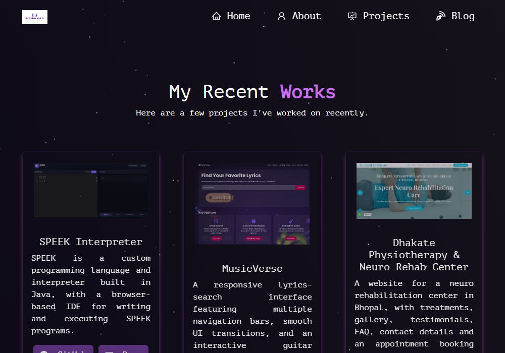

# Portfolio

My personal portfolio website, built with React. It has a short intro about me, my skills and tools, the projects I've built, and a blog.

**Live:** https://myportfolio-neon-one-99.vercel.app



## Pages

- **Home**: introduction and links
- **About**: who I am, skills and tools
- **Projects**: things I've built, with GitHub and demo links
- **Blog**: posts I write while learning

## Built with

- React
- React Bootstrap
- React Router

## Run locally

```bash
git clone https://github.com/ADHIINSVY13/My_Portfolio.git
cd My_Portfolio
npm install
npm start
```

The site opens at `http://localhost:3000`.

## Adding a blog post

Add an entry at the top of the list in `src/components/Blog/posts.js` and save.

Thanks for stopping by! Feel free to look around and get in touch.
