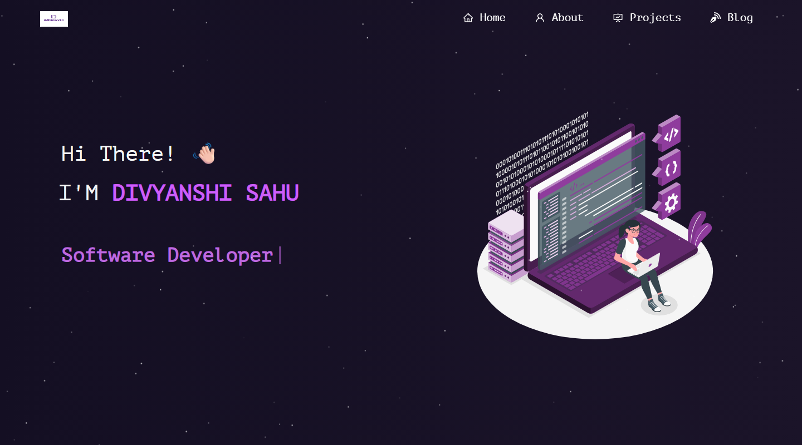
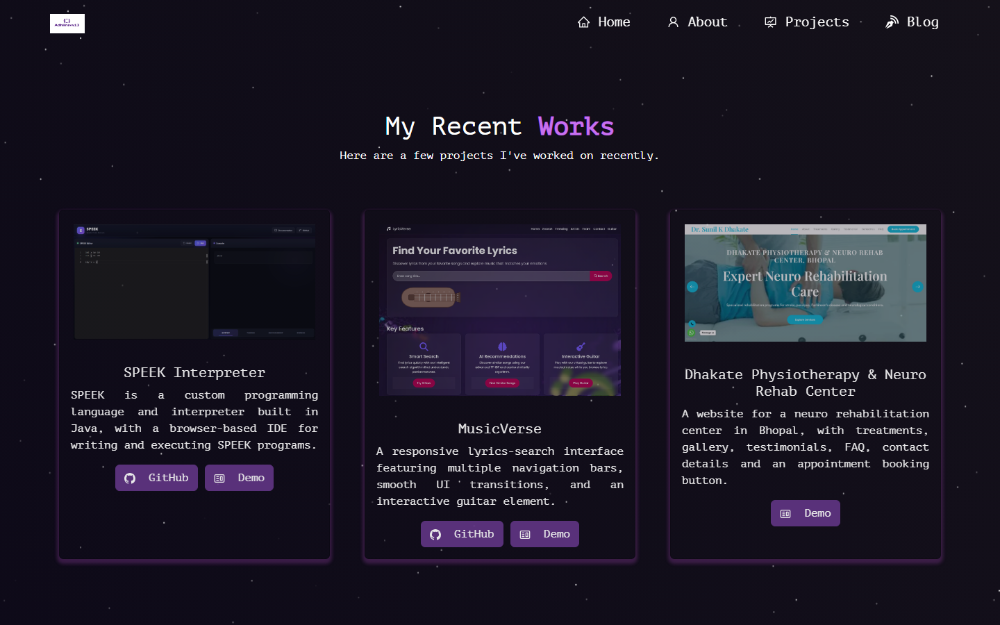

<h1 align="center">Divyanshi Sahu | Portfolio</h1>

<p align="center">
  My personal portfolio website, where I share who I am, the projects I've built, and what I'm learning.
</p>

<p align="center">
  <a href="https://myportfolio-neon-one-99.vercel.app"><b>View Live Site</b></a>
</p>



## Pages

| Page | What it shows |
| --- | --- |
| **Home** | A short introduction with an animated title |
| **About** | Who I am, my skills and the tools I use |
| **Projects** | Things I've built, each with GitHub and demo links |
| **Blog** | Posts about my projects and what I'm learning |



## Features

- Responsive layout that works on phones, tablets and desktops
- Animated starfield background and typing effect on the home page
- Project cards with screenshots, GitHub links and live demos
- Blog that automatically shows posts I publish on [Dev.to](https://dev.to/adhiinsvy13), alongside a few written directly in the site
- Preloader and smooth page transitions

## Built with

- **React**: components and routing with React Router
- **React Bootstrap** and custom CSS for the layout and styling
- **tsParticles** for the background, **Typewriter Effect** for the title
- **React Icons** for the icons
- Hosted on **Vercel**

## Run it locally

```bash
git clone https://github.com/ADHIINSVY13/My_Portfolio.git
cd My_Portfolio
npm install
npm start
```

The site opens at `http://localhost:3000`.

To create a production build:

```bash
npm run build
```

## Project structure

```
src/
├── components/
│   ├── Home/        home page and typing animation
│   ├── About/       about page, skills and tools
│   ├── Projects/    project cards
│   ├── Blog/        blog list, post page and Dev.to feed
│   ├── Navbar.js
│   └── Footer.js
├── Assets/          images and icons
└── style.css        site styles
```

## Adding a project

Add an entry to the `projects` list at the top of `src/components/Projects/Projects.js`, with a title, description, image and links.

## Writing a blog post

Publish a post on Dev.to and it appears on the Blog page automatically, with no code change. The Dev.to username is set in `src/components/Blog/devto.js`.

You can also add a post directly in the site by adding an entry to `src/components/Blog/posts.js`.

## Get in touch

- GitHub: [ADHIINSVY13](https://github.com/ADHIINSVY13)
- Email: divyanshisahu496@gmail.com

Thanks for stopping by! Feel free to look around.
